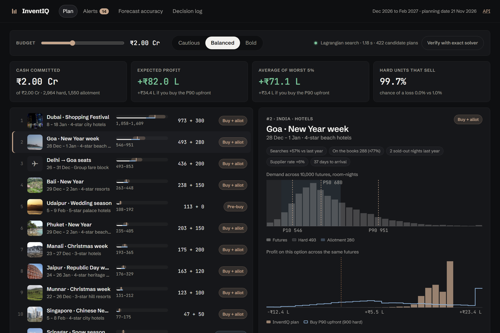
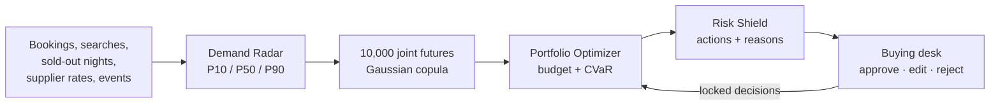
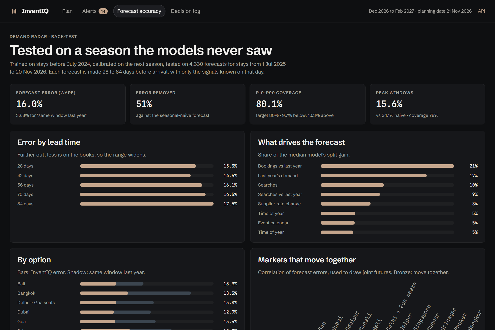

# InventIQ

[](https://github.com/LuminoSage/InventIQ/actions/workflows/ci.yml)


**Pre-buy planning for travel inventory teams.** InventIQ forecasts demand for every hotel window and
flight block as a range, plays every buying option through 10,000 joint futures, and splits a fixed
budget between hard pre-buys and releasable allotment where the risk-adjusted return is highest. A buyer
approves every buy.

Built for **TBO VoyageHack 4.0 · Problem statement 1: Inventory Optimisation**.



## The problem

A B2B travel distributor can pre-buy rooms and seats months ahead at lower rates. The trade-off:

* **Buy too little**, and on peak nights agents see "sold out" while competitors sell.
* **Buy too much**, and a room for 31 December is worth almost nothing on 1 January.
* **Demand is uncertain and the budget is fixed**, so every rupee put into Goa is a rupee not put into Dubai.

Buyers usually answer this with a single forecast and a rule of thumb such as "buy the busy-season
estimate upfront". InventIQ replaces the rule of thumb with three engines.

## How it works

| Engine | What it does | Method |
|---|---|---|
| **Demand Radar** | Forecasts each stay window as P10, P50 and P90, from bookings on the books, searches, last year's demand and sold-out nights, supplier rates and the event calendar | LightGBM quantile regression on log demand relative to last year, calibrated with conformalized quantile regression |
| **Portfolio Optimizer** | Draws 10,000 joint futures and chooses hard units and allotment for every option within one budget | Gaussian copula over split log-normal marginals; maximises `(1 − w)·E[profit] + w·CVaR₅%` with a Lagrangian search, checked against an exact mixed-integer programme (OR-Tools + SCIP) |
| **Risk Shield** | Turns the plan into actions with reasons: what to pre-buy, when to hand allotment back, which blocks to re-price, where to add a supplier | Newsvendor break-even, release-date pickup checks, elasticity-based re-pricing, supply-gap rules |



Every pick comes with its reasons in plain English. For example: *"Demand is forecast at 546 to 951 room-nights, most likely 680.
Signals: searches are up 57% on last year; bookings on the books are ahead of last year by 77%; this window sold out
on 2 nights last year. Hard: 493 at ₹5,800, 97% likely to all sell (break-even is 65%)…"*

## Results

All figures come from `python scripts/benchmark.py` on the synthetic season shipped with the repo. They
are reproducible, because every random draw is seeded.

**Forecast accuracy** (4,330 forecasts for stays from Jul 2025, never seen in training, made 28 to 84 days before arrival):

| | InventIQ (P50) | Same window last year |
|---|---|---|
| Error (WAPE) | **16.0%** | 32.8% |
| Peak windows | **15.6%** | 34.1% |
| P10–P90 band catches the actual | **80.1%** (target 80%) | – |

**The plan against "buy the P90 forecast upfront"**, scored on the same 10,000 joint futures:

| Budget | Plan | Expected profit | Average of worst 5% | Chance of a loss |
|---|---|---|---|---|
| ₹1 Cr | InventIQ, balanced | **+₹55.8 L** | **+₹52.9 L** | 0.0% |
| ₹1 Cr | Buy P90 upfront | +₹15.7 L | −₹5.7 L | 7.8% |
| ₹2 Cr | InventIQ, balanced | **+₹82.0 L** | **+₹71.1 L** | 0.0% |
| ₹2 Cr | Buy P90 upfront | +₹34.4 L | +₹3.4 L | 1.0% |

The gain has two sources: hard rooms only up to the level that is very likely to sell, and releasable
allotment, which covers the upside without tying up cash. The risk profile moves the plan along the
trade-off. At ₹3 Cr, Cautious expects +₹82.7 L with a worst 5% of +₹71.1 L, and Bold expects +₹84.5 L
with a worst 5% of +₹66.7 L.

**Optimiser quality.** The desk's fast search lands within 0.82% of the exact mixed-integer optimum in
every case tested (0.06% median), in under a second instead of 7 to 12 seconds. The desk's *Verify with
exact solver* button runs SCIP on demand.

> The data is synthetic, shaped like a B2B distributor's feeds: 12 markets, weekly stay windows from 2021,
> event calendars (New Year, Diwali, Chinese New Year, wedding seasons) and market-wide, regional and
> cluster shocks. See [docs/data.md](docs/data.md). Plugging in real booking history means replacing one
> module.

## Quick start

You need **Python 3.11 to 3.13** and **Node.js 18+**.

**Windows (PowerShell)**

```powershell
.\scripts\run.ps1
```

**macOS / Linux**

```sh
./scripts/run.sh
```

Then open **http://127.0.0.1:8000**. The first start trains the models and draws the futures (about 20
seconds) and caches them in `.cache/`, so later starts take about two seconds. The API's interactive
docs are at **http://127.0.0.1:8000/docs**.

**Docker**

```sh
docker compose up --build
```

**Step by step**

```sh
python -m venv .venv && . .venv/bin/activate      # Windows: .venv\Scripts\activate
pip install -e ".[dev]"
cd web && npm ci && npm run build && cd ..
python -m inventiq serve
```

### Command line

```sh
python -m inventiq backtest                              # forecast accuracy on the held-out season
python -m inventiq plan --budget 20000000 --risk bold    # the plan as a table
python -m inventiq plan --exact                          # also run the exact SCIP solve
python scripts/benchmark.py                              # every table in this README
```

### Development

```sh
python -m inventiq serve          # API on :8000
cd web && npm run dev             # desk with hot reload on :5173 (proxies /api to :8000)
pytest                            # 27 tests: data, forecast, futures, optimiser, shield, API
ruff check . && ruff format --check .
```

## Using the desk

1. **Set the budget and risk profile.** The plan re-optimises in about a second.
2. **Read an option.** The detail shows the demand range across 10,000 futures, the hard and allotment
   cover, the profit distribution against buying the P90 upfront, the signals and the reasons.
3. **Approve, edit or reject.** The decision is locked, and the rest of the plan is re-optimised around
   it with the budget that is left. Undo is one click.
4. **Alerts** lists re-pricing for blocks already held, supply gaps, rising supplier rates and every
   allotment release check.
5. **Forecast accuracy** shows the back-test, the drivers of the forecast and which markets move together.
6. **Decision log** is the audit trail. Decisions are appended to SQLite and never overwritten.



## Project structure

```
inventiq/
├── inventiq/                 Python package
│   ├── catalog.py            the 12 options, their unit economics and the risk profiles
│   ├── data/synth.py         synthetic booking history and signals
│   ├── forecast/             Demand Radar: features, LightGBM quantile models, CQR, back-test
│   ├── simulate/             split log-normal marginals, error correlation, Gaussian copula
│   ├── optimize/portfolio.py payoffs, CVaR, Lagrangian search, exact MILP, P90 baseline
│   ├── risk/shield.py        newsvendor line, release checks, re-pricing, supply gaps, reasons
│   ├── engine.py             wires the engines together and caches the trained state
│   ├── api/                  FastAPI app and the SQLite decision store
│   └── __main__.py           command line: build, backtest, plan, serve
├── web/                      React + TypeScript buying desk (Vite)
├── tests/                    pytest suite
├── scripts/                  one-command run scripts and the benchmark
├── docs/                     architecture, models, API, data, roadmap
├── Dockerfile, docker-compose.yml
└── .github/workflows/ci.yml  lint, tests on Python 3.11 to 3.13, web build
```

## Documentation

* [Architecture](docs/architecture.md): components, data flow, caching and performance
* [Models and maths](docs/models.md): every formula the engines use, and why
* [API](docs/api.md): endpoints with examples
* [Data](docs/data.md): the synthetic generator, the data dictionary and how to plug in real data
* [Roadmap](docs/roadmap.md): from prototype to a pilot on real bookings

## Licence

MIT. Destination photographs are from Wikimedia Commons under Creative Commons licences; see
[CREDITS.md](CREDITS.md).
