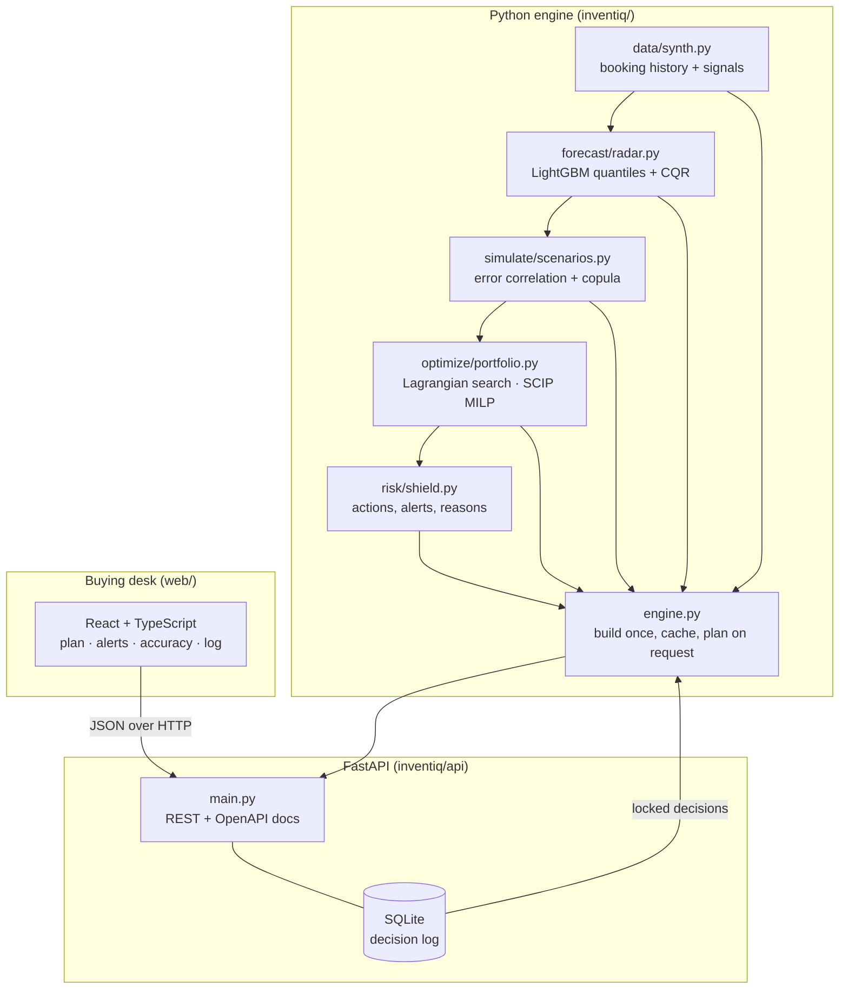

# Architecture

## Components

| Layer | Path | Responsibility |
|---|---|---|
| Catalogue | `inventiq/catalog.py` | The 12 options, their event calendars, unit economics and the risk profiles |
| Data | `inventiq/data/synth.py` | Seeded synthetic history: 15,000+ rows of stay windows × lead times |
| Forecast | `inventiq/forecast/` | Features, three quantile models, conformal calibration, back-test, feature importance |
| Futures | `inventiq/simulate/scenarios.py` | Split log-normal marginals, correlation estimation with shrinkage, Gaussian copula |
| Optimiser | `inventiq/optimize/portfolio.py` | Payoffs, CVaR, candidate generation, fast search, exact MILP, P90 baseline |
| Shield | `inventiq/risk/shield.py` | Actions, alerts and plain-English reasons |
| Engine | `inventiq/engine.py` | Orchestration, on-disk cache, plan cache, response shaping |
| API | `inventiq/api/` | REST endpoints, validation, decision store, serves the built desk |
| Desk | `web/` | React single-page app with hand-built SVG charts and no chart library |

## Request flow: moving the budget slider

1. The desk sends `POST /api/plan {budget, risk}`.
2. The API reads the locked decisions from SQLite: approved and edited options keep their units, and
   rejected ones get none.
3. The engine looks up its plan cache, keyed by budget (to ₹1 lakh), risk profile and locked decisions.
4. On a miss, the optimiser solves (about 0.6 s). The engine then scores the plan and the P90 baseline on
   all 10,000 futures, and builds histograms, statistics, alerts and reasons.
5. The desk renders the list, the selected option's detail and the portfolio chart.

## Performance

| Step | Time |
|---|---|
| Generate data, back-test, train, calibrate, estimate correlations | about 20 s, once |
| Later starts (cached in `.cache/engine-<hash>.pkl`) | about 2 s |
| Plan request, fast search | 0.6 to 1.2 s |
| Plan request, exact SCIP solve | 7 to 12 s |
| Cached plan request | under 20 ms |

The cache key is a hash of the package source, so any code change retrains automatically.

## Determinism

Every random draw uses a fixed seed: the data (2026), the futures (11) and LightGBM (`deterministic=True`,
single thread). The same commit always produces the same forecasts, plans and numbers, which is what
makes the README's tables reproducible.

## Replacing the synthetic data

`synth.generate()` returns two tables, `history` and `current`, with the columns listed in
[data.md](data.md). A real deployment replaces that one function with a loader over the booking,
search and supplier-rate warehouse. Nothing downstream changes.

## Security and operations notes

* The API has no authentication. It is meant to run inside the company network, or behind the existing
  single sign-on proxy.
* Inputs are validated with Pydantic: budget bounds, known risk profiles, units within the supplier's
  caps, and notes of at most 500 characters.
* The decision log is append-only. An "undo" is a new row, so the audit trail is never rewritten.
